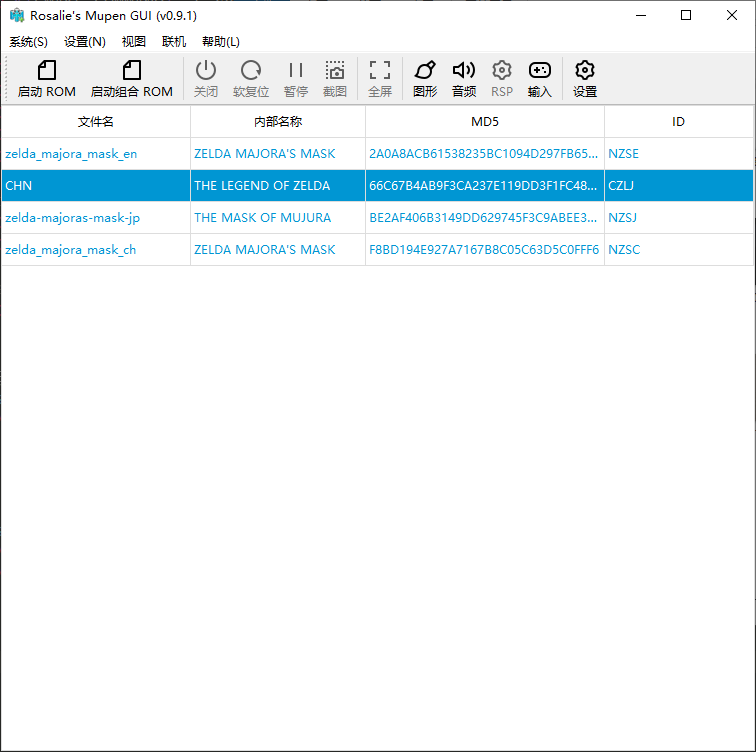
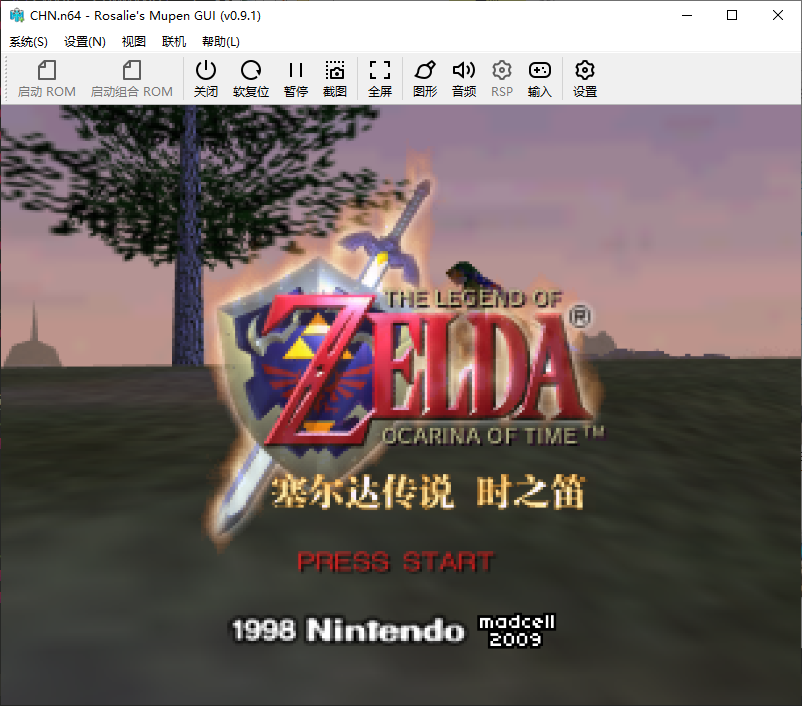
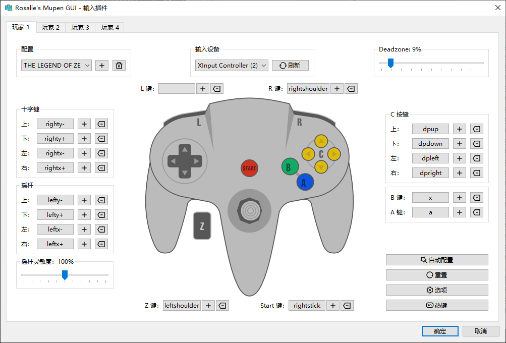

[English](README_en.md) | [简体中文](README.md)

# Rosalie's Mupen GUI

Rosalie's Mupen GUI 是一个使用 C++ 编写的免费、开源的 mupen64plus 前端。

它提供了简单易用的用户界面。

## 下载

#### Windows
你可以在 [Github Releases](https://github.com/Rosalie241/RMG/releases) 下载 Rosalie's Mupen GUI

#### Linux
你可以通过以下途径下载 Rosalie's Mupen GUI
* [Github Releases (AppImage)](https://github.com/Rosalie241/RMG/releases)
* [Flathub (Flatpak)](https://flathub.org/apps/details/com.github.Rosalie241.RMG)
* [Arch User Repository](https://aur.archlinux.org/packages/rmg)
* [Fedora COPR](https://copr.fedorainfracloud.org/coprs/rosalie/RMG/)

## 网络对战

你可以通过以下方式使用网络对战：

### 端口转发

1) 下载 [rmg-netplay-server](https://github.com/Rosalie241/rmg-netplay-server/releases/latest)
2) 在路由器上转发 [rmg-netplay-server README](https://github.com/Rosalie241/rmg-netplay-server) 中所述的端口
3) 创建一个 JSON 文件，内容与下面类似，但请使用你的公网 IP 而不是本地 IP：
```
{
  "some-server-name": "127.0.0.1"
}
```
如果你想添加多个服务器：
```
{
  "some-server-name": "127.0.0.1",
  "some-server-name-2": "127.0.0.1"
}
```
4) 将该 JSON 文件保存到本地，或上传到某个可访问的位置
5) 在 RMG 设置对话框的“服务器列表 URL”文本框中填入该 JSON 文件的路径或 URL
6) JSON 文件中指定的服务器应该会出现在 RMG 界面中


### 内网穿透软件

1) 下载 [rmg-netplay-server](https://github.com/Rosalie241/rmg-netplay-server/releases/latest)
2) 下载 [Radmin VPN](https://www.radmin-vpn.com/)
3) 运行 Radmin VPN，并创建或加入一个网络
4) 由主机运行 [rmg-netplay-server](https://github.com/Rosalie241/rmg-netplay-server)
5) 该服务器应该会以 `local-server` 的形式出现在 RMG 界面中

## 支持

你可以在 [Github](https://github.com/Rosalie241/RMG/issues/new) 上寻求帮助或报告问题

## 许可证

Rosalie's Mupen GUI 基于 [GNU General Public License v3.0](https://www.gnu.org/licenses/gpl-3.0.en.html) 许可发布。

## 展示





## 构建

#### Linux
* Debian/Ubuntu 便携构建

  ```bash
  sudo apt-get -y install cmake libusb-1.0-0-dev libhidapi-dev libsamplerate0-dev libspeex-dev libminizip-dev libsdl3-dev libfreetype6-dev libgl1-mesa-dev libglu1-mesa-dev pkg-config zlib1g-dev binutils-dev libspeexdsp-dev qt6-base-dev qt6-websockets-dev libqt6svg6-dev libvulkan-dev qt6-tools-dev qt6-l10n-tools build-essential nasm git zip ninja-build
  ./Source/Script/Build.sh Release
  ```
  
* Fedora 便携构建
  ```bash
  sudo dnf install libusb1-devel hidapi-devel libsamplerate-devel minizip-compat-devel SDL3-devel freetype-devel mesa-libGL-devel mesa-libGLU-devel pkgconfig zlib-ng-devel binutils-devel speexdsp-devel qt6-qtbase-devel qt6-qtsvg-devel qt6-qtwebsockets-devel qt6-qttools-devel qt6-linguist vulkan-devel gcc-c++ nasm git ninja-build
  ./Source/Script/Build.sh Release
  ```

* Arch Linux 便携构建
  ```bash
  sudo pacman -S --needed make cmake gcc libusb hidapi freetype2 libpng qt6 qt6-tools sdl3 libsamplerate nasm minizip pkgconf vulkan-headers git
  ./Source/Script/Build.sh Release
  ```

* OpenSUSE Tumbleweed 便携构建
  ```bash
  sudo zypper install SDL3-devel cmake freetype2-devel gcc gcc-c++ libusb-1_0-devel libhidapi-devel libhidapi-hidraw0 libpng16-devel libsamplerate-devel make nasm ninja pkgconf-pkg-config speex-devel vulkan-devel zlib-devel qt6-tools-devel qt6-opengl-devel qt6-widgets-devel qt6-svg-devel minizip-devel git
  ./Source/Script/Build.sh Release
  ```

构建完成后，可执行文件位于 `Bin/Release` 目录中

* 安装/打包
```bash
export src_dir="$(pwd)"
export build_dir="$(pwd)/build"
mkdir -p "$build_dir"
cmake -S "$src_dir" -B "$build_dir" -DCMAKE_BUILD_TYPE="Release" -DPORTABLE_INSTALL="OFF" -DCMAKE_INSTALL_PREFIX="/usr" -G "Ninja"
cmake --build "$build_dir"
cmake --install "$build_dir" --prefix="/usr"
```

#### Windows
* 下载并安装 [MSYS2](https://www.msys2.org/)（UCRT64）
```bash
pacman -S --needed make mingw-w64-ucrt-x86_64-cmake mingw-w64-ucrt-x86_64-gcc mingw-w64-ucrt-x86_64-libusb mingw-w64-ucrt-x86_64-hidapi mingw-w64-ucrt-x86_64-freetype mingw-w64-ucrt-x86_64-libpng mingw-w64-ucrt-x86_64-qt6 mingw-w64-ucrt-x86_64-sdl3 mingw-w64-ucrt-x86_64-speexdsp mingw-w64-ucrt-x86_64-libsamplerate mingw-w64-ucrt-x86_64-libusb mingw-w64-ucrt-x86_64-nasm mingw-w64-ucrt-x86_64-minizip mingw-w64-ucrt-x86_64-vulkan-headers mingw-w64-ucrt-x86_64-openssl mingw-w64-ucrt-x86_64-libjpeg-turbo git
./Source/Script/Build.sh Release
```

构建完成后，可执行文件位于 `Bin/Release` 目录中
